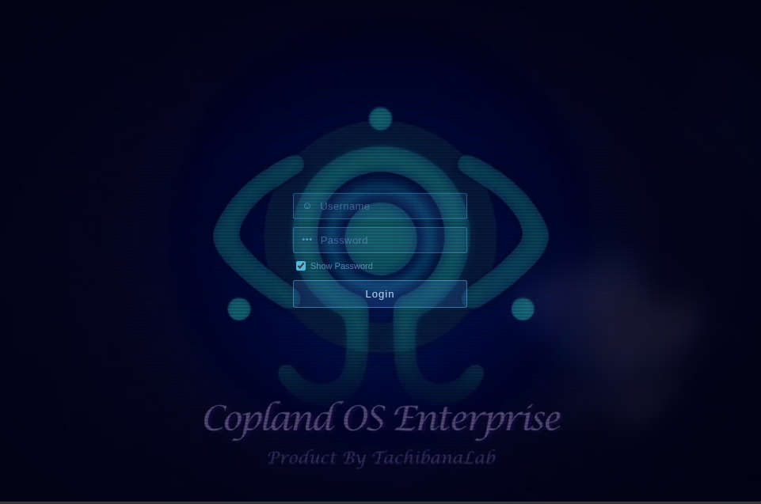
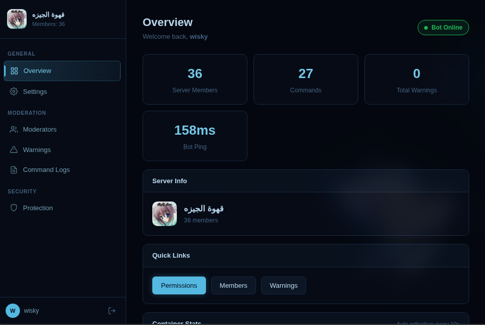
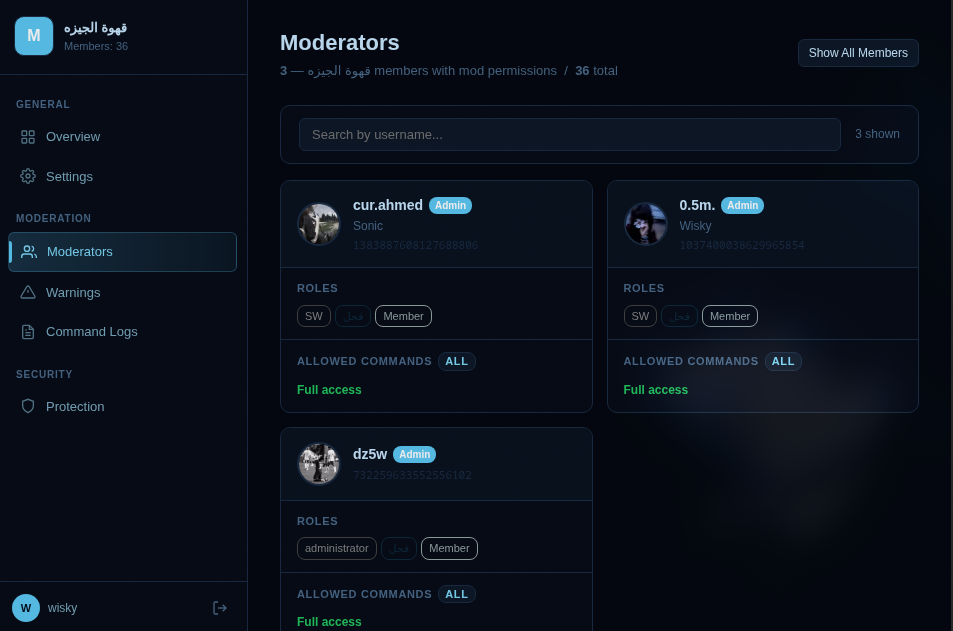
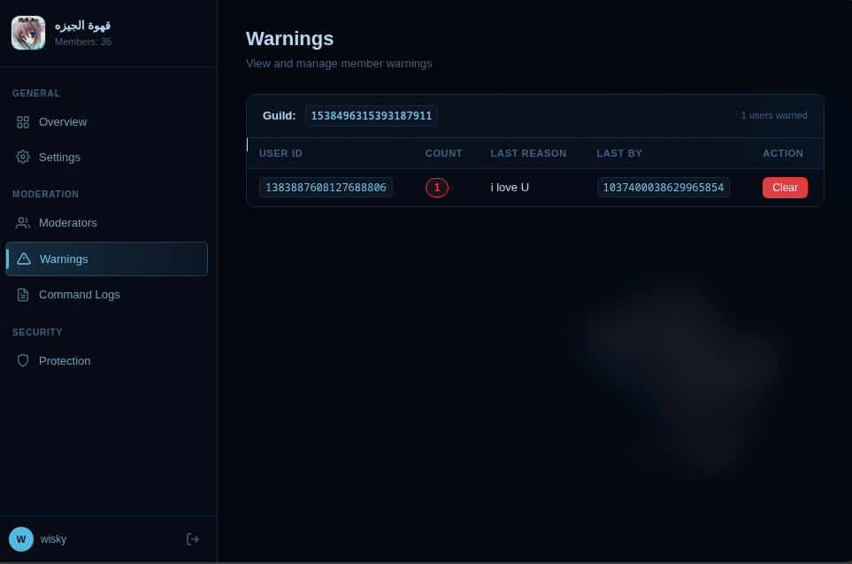
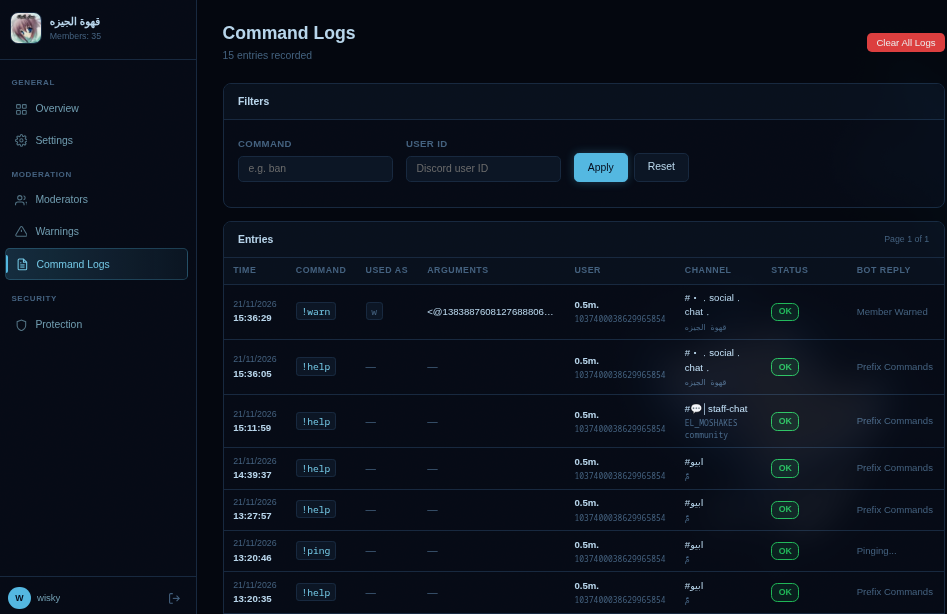
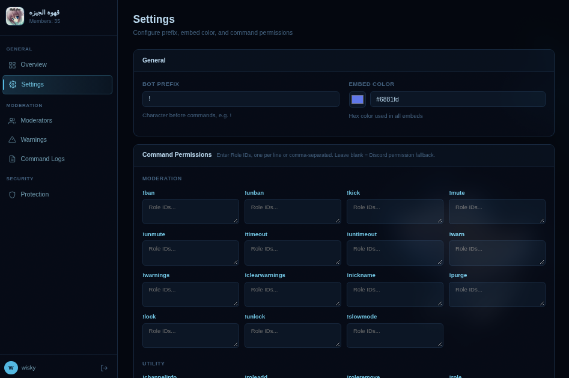
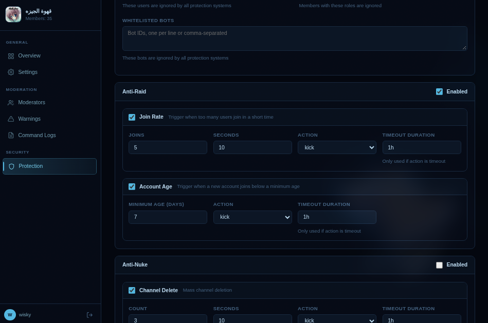

# EL MOSHAKES

A Discord moderation bot built with discord.js v14, featuring a web dashboard and server protection system.

<div align="center">



</div>

---

## Dashboard

<div align="center">



</div>

<div align="center">

| Members | Warnings |
|:---:|:---:|
|  |  |

| Logs | Settings |
|:---:|:---:|
|  |  |

</div>

<div align="center">



</div>

---

## Setup

**1. Install dependencies**
```
npm install
```

**2. Configure environment**

Copy `.env.example` to `.env` and fill in your values:

| Variable | Description |
|---|---|
| `TOKEN` | Discord bot token |
| `CLIENT_ID` | Bot Application ID |
| `GUILD_ID` | Your server ID |
| `PREFIX` | Command prefix (default `!`) |
| `DASHBOARD_PORT` | Dashboard port (default `3000`) |
| `DASHBOARD_SECRET` | Random secret string for session encryption |
| `DASHBOARD_USERNAME` | Dashboard login username |
| `DASHBOARD_PASSWORD` | Dashboard login password |

**3. Start**
```
node index.js
```

Dashboard: `http://localhost:<DASHBOARD_PORT>`

---

## Commands

### Moderation

| Command | Aliases |
|---|---|
| `!ban` | نكح, تف, سيف, إعدام, اعدم, تقليع, تفنيش, تلطيش, كربج, ban |
| `!unban` | إفراج, افراج, اعفاء, unban |
| `!kick` | برا, بره, اطرد, kick |
| `!mute` | اسكت, اخرس, اكتم, mute |
| `!unmute` | اتكلم, unmute |
| `!timeout` | تأديب, تاديب, نام, timeout |
| `!untimeout` | اصحى, اتايب, untimeout |
| `!warn` | w |
| `!warnings` | warns, listwarns |
| `!clearwarnings` | cw, clearwarns |
| `!nickname` | nick, n, setnick, #nick, اسم, nickname |
| `!purge` | clear, c, prune, نظف, تنظيف |
| `!lock` | lk, قفل, lock |
| `!unlock` | ulk, فك, افتحه, unlock |
| `!slowmode` | sm |

### Utility

| Command | Aliases |
|---|---|
| `!ping` | pong |
| `!help` | h, commands |
| `!userinfo` | ui, whois |
| `!serverinfo` | si, guildinfo |
| `!avatar` | av, pfp |
| `!botinfo` | bi, info |
| `!afk` | away |
| `!channelinfo` | ci |
| `!roleadd` | ra, خد, حط, give |
| `!roleremove` | rr, شيل, هات, remove |
| `!role` | r |
| `!خط` | khat, line |

---

## Permissions System

- Roles configured in dashboard — only members with that role can use the command.
- No roles configured (empty) — falls back to Discord's native permissions.
- Administrators always bypass all permission checks.
- Members with equal or higher roles than the moderator are protected from moderation actions.

---

## Protection System

### Anti-Nuke

Detects and responds to mass destructive actions. Each feature is configurable independently with its own threshold, window, and punishment.

| Feature | Trigger |
|---|---|
| Channel Delete | Mass channel deletion |
| Channel Create | Mass channel creation |
| Channel Edit | Mass channel edits |
| Role Delete | Mass role deletion |
| Role Create | Mass role creation |
| Role Edit | Mass role edits |
| Mass Ban | Multiple bans in a short time |
| Mass Kick | Multiple kicks in a short time |
| Webhook Create | Mass webhook creation |

When triggered, the bot punishes the executor and **restores** the deleted or modified resource from the last snapshot.

### Anti-Raid

| Feature | Trigger |
|---|---|
| Join Rate | Too many users joining in a short time |
| Account Age | Account created too recently |

### Whitelist

Users, roles, and bots can be whitelisted from the dashboard — the bot ignores all their actions.

### Actions

Each protection feature supports: `ban`, `kick`, `timeout` (with configurable duration).

---

## Dashboard Pages

| Page | URL | Description |
|---|---|---|
| Overview | `/dashboard` | Bot status, server info, container stats |
| Moderators | `/members` | Members with mod permissions and their allowed commands |
| Command Logs | `/logs` | Log of every command used |
| Settings | `/settings` | Prefix, embed color, per-command role permissions, `!خط` message |
| Warnings | `/warnings` | View and clear member warnings |
| Protection | `/protection` | Anti-Raid and Anti-Nuke configuration |

---

## Required Bot Permissions

Administrator (recommended), or:
- Ban Members, Kick Members, Moderate Members
- Manage Messages, Manage Channels, Manage Roles, Manage Nicknames
- Send Messages, Embed Links, Read Message History
- View Audit Log (required for protection system)
